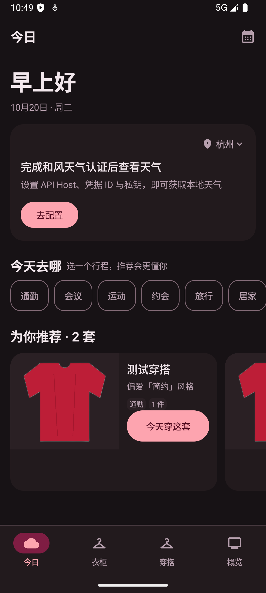
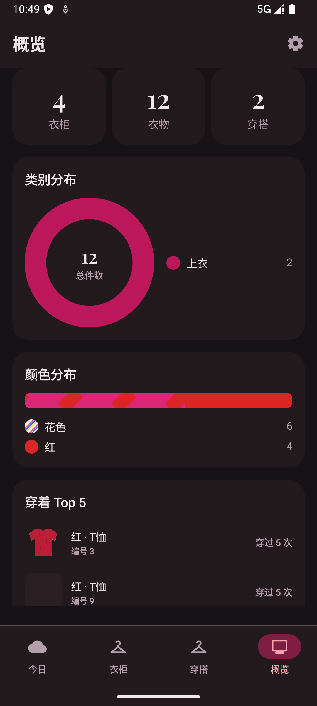
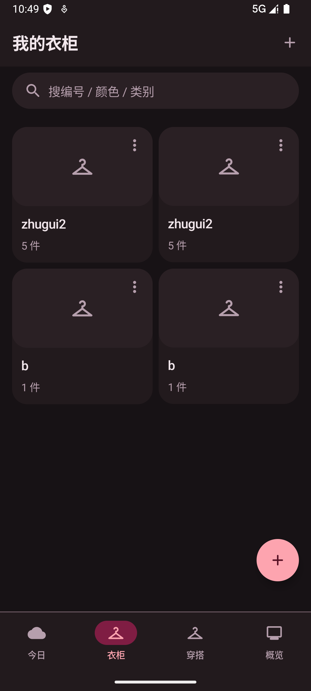
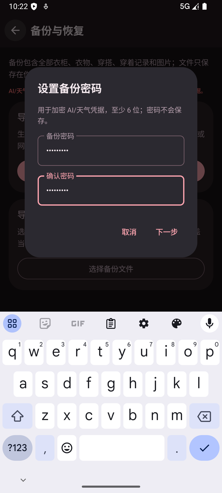

# ClothesMate 穿什么

一款**纯本地存储**的 Android 衣柜与穿搭管理应用：记录衣物、搭配穿搭、按天气与行程推荐今天的穿搭，并用穿着记录回看自己的衣橱。

- 无账号、无云同步、无广告、无遥测
- 不依赖 Google Play Services，可在无 GMS 设备上使用
- 抠图在设备端完成，不上传照片
- AI 识别只做表单预填，任何 AI 建议都必须由用户确认

## 功能

- **衣柜**：多衣柜、编号、分类/颜色/风格/季节标签、搜索与筛选
- **录入**：相机完整录入、快速连拍（后台抠图与取色）、相册导入
- **穿搭**：穿搭分类、衣物组合、一衣多穿反查
- **今日**：实时天气、行程标签、规则推荐、推荐理由与兜底组合
- **穿着记录**：确认穿着、同日多套、历史日历与备注
- **概览**：Top/压箱底、30 天热力图、颜色与季节分布
- **备份**：完整 zip 导出/导入；AI/天气凭据用备份密码加密
- **设置**：深色模式、AI 服务商、和风天气 JWT 认证、风格偏好

## 截图

| 今日 | 概览 |
|---|---|
|  |  |

| 衣柜 | 穿着日历 |
|---|---|
|  |  |



> 截图使用演示数据；不包含 API Key、真实个人信息或本机路径。

## 构建

需要 JDK 17+、Android SDK 37（compileSdk/targetSdk 37）。

```bash
# Debug
./gradlew assembleDebug

# 单元测试与 lint
./gradlew testDebugUnitTest lintDebug
```

如本机没有 `local.properties`，请设置 `ANDROID_HOME` / `ANDROID_SDK_ROOT` 指向 Android SDK。

### Release 签名

Release 构建**不会回退到 debug 签名**。请在本机创建（不要提交）：

`keystore.properties`

```properties
storeFile=/absolute/path/to/your-release.keystore
storePassword=...
keyAlias=...
keyPassword=...
```

请在本机用 `keytool` 生成 PKCS12 keystore，并把路径与密码写入上述本地文件。缺少该文件时 `assembleRelease` 会明确失败。

版本策略：`versionCode = major*10000 + minor*100 + patch`；首发 `1.0.0`（`10000`）。

## AI 与天气

- **AI**：用户可选择 DeepSeek（只需 API Key）或任意 OpenAI 兼容端点（Base URL + API Key + 支持图片输入的模型名）。Key 使用 Android Keystore 加密后存于本机；识别请求只发送到用户配置的端点。
- **天气**：用户自行配置和风天气 API Host、凭据 ID、项目 ID、Key ID 与 Ed25519 私钥，应用在本机生成 JWT；未配置时天气降级，不影响抠图、衣柜与推荐。
- 应用**不内置任何 API Key**。

## 数据与备份

所有衣物、穿搭、图片和设置默认只保存在应用私有目录。备份 zip 由用户选择保存位置；zip 中的 AI/和风凭据以用户设置的备份密码加密，密码不会保存在应用中，**遗忘后无法恢复凭据**。

## 隐私

请阅读 [PRIVACY.md](PRIVACY.md)。

## 许可

本项目以 [Apache License 2.0](LICENSE) 发布。

随包/随仓库分发的第三方组件许可：

- U²-Net u2netp 模型：Apache-2.0（见 `licenses/u2netp-Apache-2.0.txt`）
- Playfair Display 字体：SIL Open Font License 1.1（见 `licenses/PlayfairDisplay-OFL.txt`）
- EdDSA-Java：CC0-1.0（见 `licenses/eddsa-CC0-1.0.txt`）

## 更新

应用通过 GitHub Releases 分发；更新检查只请求公开仓库的版本元数据，不携带衣柜数据、账号或设备标识。正式发布说明见 `docs/release-notes-template.md`。
